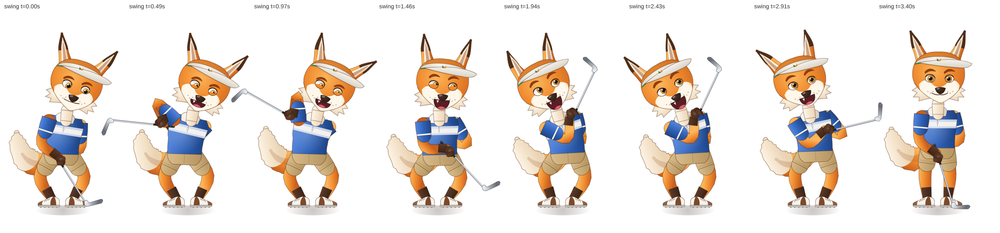

# Birdie the Fox — rigged 2D mascot

A fully rigged, code-drawn game mascot: a fox golfer in the painted-cartoon style of the Olaf golfer,
built as a **2D skeletal (cut-out) rig** for Canvas 2D. Everything — artwork, skeleton, solver, clips,
viewer, atlas export, validation — is generated by code in this folder, so the character can be
re-proportioned, re-dressed and re-animated without repainting frames.



| Deliverable | Path |
|---|---|
| Interactive viewer (desktop + phone layouts) | `viewer.html` — `npm run viewer`, then <http://localhost:8765/mascots/fox/viewer.html> |
| Skeleton + channels | `src/skeleton.js` |
| Pose solver (FK, IK, two-hand grip, follow-through) | `src/solver.js` |
| Vector artwork | `src/art.js`; draw order in `src/renderer.js` |
| Animation clips (11) | `src/clips.js` |
| Playback controller / game adapter | `src/rig.js` |
| Sprite-atlas export (game format) | `src/atlas.js`, `scripts/export-atlas.mjs` |
| Validation (107 checks) | `scripts/validate.mjs` → `validation/report.json` |
| Contact sheets, GIF previews, viewer screenshots | `validation/sheets/`, `validation/previews/`, `validation/viewer-*.png` |

```bash
npm run fox:validate     # pure-Node structural checks (no browser)
npm run fox:sheets       # contact sheets for every clip (headless Chromium)
npm run fox:preview      # animated GIF per clip (needs ffmpeg)
npm run fox:atlas        # packed PNG pages + JSON manifest for the Canvas 2D game
npm run fox:viewer-test  # loads the viewer at desktop and phone sizes, checks events
```

## The rig

**Skeleton** — 35 bones, authored in a y-down "upright world" frame with the origin on the ground
between the feet (`src/skeleton.js`):

```
root → pelvis → spine_01 → chest → neck → head → ear_L_01 → ear_L_02 / ear_R_01 → ear_R_02
                      ├─ clavicle_L/R → upperarm → forearm → hand
                      └─ club (free bone, parented to the chest; both hands IK onto its grip markers)
         pelvis ├─ thigh_L/R → shin → foot
                └─ tail_01 → … → tail_05
```

Bone lengths are constants; nothing a clip does can stretch one (validated to 1e-6 px every frame).
Sides are from the character's perspective (`_L` = screen +x). Rotations are deltas from the rest
pose in the parent's frame, clockwise positive.

**Solver** (`src/solver.js`) is a pure function of `(clip, time)`:

1. sample every track (per-key easing: smooth / in / out / snap / back / bounce / step; loops
   interpolate from the last key back to the first),
2. forward kinematics,
3. **planted feet**: two-bone IK keeps both ankles on their ground spots while the pelvis crouches,
   sways or hops (feet stay flat; a lifted foot droops its toes with height),
4. **hands**: explicit IK targets (root space or any bone's upright frame), or the **two-hand club
   constraint** (`grip` 1 = both paws, 2 = lead paw only, 3 = trailing paw only; wrists align with the shaft),
5. **follow-through** for the five tail bones and both ear tips: each link trails the pelvis/head by a
   fixed delay (re-sampling the primary pose at `t − delay`), so there is no simulation state —
   scrubbing, frame skips, turbo and reloads give identical poses,
6. root-only **squash & stretch** about the ground origin.

**Face/body channels** (not bones): per-eye blink, squint, two brows + tilt, smile ↔ frown, mouth
open, tongue, gaze (pupil x/y, size), paw open ↔ fist, blush, and stepped draw-order switches
(`armLFront`, `armRFront`, `clubBehind`, `clubVisible`) so the backswing can cross the chest.

**Artwork** (`src/art.js`): limbs, torso, tail and ears are *lofted* along their bone chains (a smooth
tube swept through the joints with per-point widths, gradient shading across the tube, fur jitter on
the tail), so they bend instead of hinging like paper. Rigid pieces (head, paws, shoes, visor, iron)
are drawn in their bone's upright frame. Face: almond eyes with iris/pupil/highlights, lids that blink
and squint, fur-tuft brows, muzzle mask, nose with gloss, philtrum, whisker dots, cheek ruffs, an
open mouth with tongue and fang; polo shirt with collar/placket/cuffs, belted shorts, saddle golf
shoes with cleats, sun visor with a fox logo, dark "stocking" fur on the shins and paws.

## Clips (`src/clips.js`)

| clip | loop | content | markers |
|---|---|---|---|
| `idle` | ✓ 6 s | **stationary** standing pose leaning on the club; only the eyelids move (one blink + one double blink) | |
| `idle_breathe` | ✓ 4.8 s | breathing, slow tail wave, ear flick, glance at the tee | |
| `wave` | 2.8 s | right paw leaves the club, waves 3×, big smile | `raised` |
| `walk` | ✓ 0.9 s | in-place strut, club over the right shoulder, free arm swings | |
| `run` | ✓ 0.56 s | in-place sprint with flight phase, ears back, tongue out | |
| `jump` | 1.7 s | squat, stretch, tuck, squash landing | `takeoff` `apex` `land` |
| `celebrate` | 3.0 s | two fist pumps with a hop, blush, tail wag | `pump` `pump2` |
| `address` | 1.4 s | eyes to the ball, knees bend, club head settles behind the ball | `set` |
| `swing` | 3.4 s | backswing over the right shoulder → **contact at 1.42 s** → follow-through over the left shoulder → standing | `top` `contact` `finish` |
| `drive` | 4.2 s | Long Drive: fuller turn, **contact at 1.8 s**, hop and lean to steer the ball | `top` `contact` `finish` |
| `miss` | 3.0 s | ears droop, worried brows, head shake, tail sinks | |

The golf clips are placed against a tee anchor `BALL = (105, −8)` in root space; the address and
contact club placements were fitted numerically against the body pose so the club face is on the ball
at the contact marker (validated: ≤ 24 px, moving toward the target at > 300 px/s).

## Using it in a game

```js
import { createRig, animate } from './src/rig.js';
const rig = createRig();                       // dispatches window events fox:<marker>
await rig.play('swing', { resolveAt: 'contact' });   // resolves exactly at club contact → launch the ball
rig.draw(ctx, { x: 420, y: 560, scale: 0.6, mirror: true });
```

`rig.advance(dt)` fires every marker that falls inside the elapsed interval **once**, whatever the frame
step or speed; `rig.seek(t)` never fires markers. This mirrors the Olaf adapter contract
(`play('swing')` resolves at contact; rendering never decides outcomes). Mirror with `view.mirror` for
the desktop layout where the golfer faces the grid.

`npm run fox:atlas` renders clips at 30 fps to trimmed, de-duplicated frames on 2048-px PNG pages plus a
manifest shaped like `painted-swing/olaf-swing.json` (pages, frames with `offsetX/offsetY`, clips with
frame indices and marker frames, anchors with foot/contact positions). The stationary `idle` collapses
to 4 unique frames. Default export set: idle, address, swing, celebrate, miss (8 pages, ~107 MiB
decoded at 512-px frames); pass clip names or `--all`.

## Validation (`npm run fox:validate`)

107 checks, all passing — per clip at 60 Hz plus exact marker times: bone lengths constant, finite
transforms, planted feet never drift or go under the ground, hands reach the grip, stepped draw-order
channels, follow-through bounded, determinism, seamless loops; the stationary idle moves no bone and
changes only the blink channels; club head at the ball and moving toward the target at contact, behind
the head at the top of the backswing; address club head behind the ball; the player fires markers once
at 60 fps, with 0.45 s frame skips and at 3× turbo, never on scrubbing, and `play('swing')` resolves at
contact. `scripts/viewer-shot.mjs` loads the viewer at 1280×800 and 390×844 (touch) and confirms a
single `fox:contact` event per live swing.

Visual checks were done on headless Chromium renders (contact sheets, GIFs, viewer screenshots);
on-device browser performance was not measured here.

## Extending

* Proportions: edit `BONE_DEFS`; art widths live next to each part in `src/art.js`.
* New clip: add tracks to `src/clips.js` (every key is `[time, value, ease]`); markers are seconds.
* Another animal: the skeleton, solver, player, atlas export and validation are species-agnostic; swap
  `src/art.js` and the rest-pose positions.
