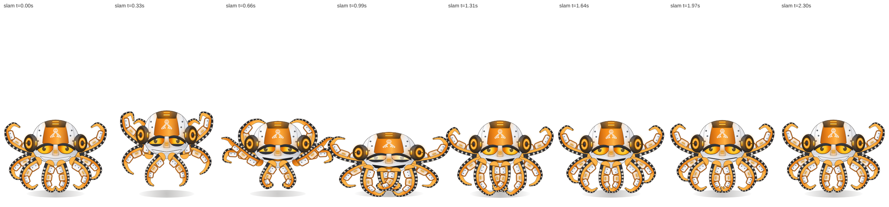

# Krakenbot — rigged 2D mech-octopus mascot

A code-drawn mech octopus (orange/white/gunmetal armour, glowing amber lights, furious visor eyes,
headphone-style side pods, an octopus crest logo, eight plated tentacles with suckers) built as a
**2D skeletal cut-out rig** for Canvas 2D, in the same framework as the fox mascot (`../fox`).



| Deliverable | Path |
|---|---|
| Interactive viewer (desktop + phone layouts) | `viewer.html` — `npm run viewer`, then <http://localhost:8765/mascots/octo/viewer.html> |
| Skeleton + channels | `src/skeleton.js` (46 bones: root, body, head, 2 pods, crest, 8 × 5 tentacle links) |
| Pose solver (FK, CCD tentacle IK, ripple, follow-through, floor) | `src/solver.js` |
| Vector artwork / draw order | `src/art.js`, `src/renderer.js` |
| Animation clips (11) | `src/clips.js` |
| Playback controller | `src/rig.js` (events `octo:<marker>`) |
| Sprite-atlas export | `src/atlas.js`, `scripts/export-atlas.mjs` |
| Validation (97 checks) | `scripts/validate.mjs` → `validation/report.json` |
| Contact sheets, GIF previews, viewer screenshots | `validation/sheets/`, `validation/previews/`, `validation/viewer-*.png` |

```bash
npm run octo:validate     # pure-Node structural checks (no browser)
npm run octo:sheets       # contact sheets for every clip (headless Chromium)
npm run octo:preview      # animated GIF per clip (needs ffmpeg)
npm run octo:atlas        # packed PNG pages + JSON manifest (idle, hover, slam, celebrate, hurt by default; --all)
npm run octo:viewer-test  # loads the viewer at desktop and phone sizes, checks events
```

## The rig

**Skeleton.** `root → body → head → pod_L / pod_R / crest`, and eight five-link tentacle chains
parented to the body, named by position: `tent_F*` front centre, `tent_M*` mid (sides, in front of
the body), `tent_U*` upper (raised, behind the head), `tent_B*` back. Bone lengths are constants
(validated to 1e-6 px every frame). Sides are from the character's perspective (`_L` = screen +x).

**Solver** (`src/solver.js`), a pure function of `(clip, time)`:

1. track sampling with per-key easing; `tent:<name>` keys set a tentacle's **total curl** in degrees,
   distributed tip-biased over its five links;
2. forward kinematics;
3. **CCD IK** for any tentacle with an `ik:` target (24 sweeps, per-link joint limits 140/100/80/70/70°,
   children keep their relative angles); a `curl` makes the tip coil around an object while the fourth
   link's end does the reaching (the `grab` clip picks something up and lifts it to the visor);
4. **travelling ripple** along every tentacle (integer cycles per loop, so loops stay seamless);
5. **stateless follow-through**: each link trails the body by a fixed delay per link, re-sampling the
   primary pose at `t − delay`, so there is no simulation state — scrubbing, frame skips, turbo and
   reloads give identical poses;
6. **floor constraint**: a tentacle whose tip would sink below the ground is bent back up to rest on it;
7. root-only squash & stretch about the ground origin.

**Channels** (not bones): per-eye armoured blink shutters, squint, brow (−1 surprised … +1 furious),
gaze (pupil x/y/size), light intensity `glow`, `eyeHeat` (amber → white-hot), `visorFlash`, chin plate
`mouth`, `podSpin` (ring notch), `ripple` amplitude, follow-through gain, and stepped draw-order switches
(`midOverHead`, `frontOverHead`) so tentacles can pass behind the dome during a wind-up.

**Artwork** (`src/art.js`): tentacles are lofted tubes swept along the five links with per-point widths,
an orange gradient across the tube, a dark underside band with cream suckers (sized along the taper),
and segmented white armour plates with orange trim, twin bolts and a glowing slit on the first three
links. The dome is a rigid piece in the head frame: white shell with seams and bolts, orange centre panel
with the octopus crest logo, dark top plate with two light bars, slanted angry eyes with glowing irises,
pupils, highlights and heavy brow wedges, nose plate with two slits, drop-down chin plate with an
orange intake glow, and gunmetal side pods with glowing rings and rim lamps. Every light is a
radial-gradient halo (no shadowBlur), so the glow scales with `glow` and stays cheap.

## Clips (`src/clips.js`)

| clip | loop | content | markers |
|---|---|---|---|
| `idle` | ✓ 6 s | **stationary** hover; only the eye shutters blink | |
| `hover` | ✓ 4 s | bob, drifting tentacles, ripple, pulsing lights, spinning pods, a glance | |
| `wave` | 2.8 s | upper-left tentacle rises and waves its tip 3× | `raised` |
| `taunt` | 2.6 s | tentacles flare wide, brows slam down, white-hot eyes, visor flash, pods spin up | `flash` |
| `slam` | 2.3 s | side tentacles rear up behind the head, whip into the ground, squash + shake | `windup` `slam` `recover` |
| `grab` | 3.2 s | front-left tentacle reaches (CCD), coils around an object, lifts it to the visor, puts it back | `reach` `wrap` `lift` `release` |
| `jump` | 1.8 s | coil, stretch launch, tentacles trail, heavy squash landing | `takeoff` `apex` `land` |
| `celebrate` | 3.0 s | victory bounces, upper tentacles pump, lights blaze | `pump` `pump2` |
| `hurt` | 2.2 s | visor flash, knocked sideways, lights flicker, limp tentacles, reboot | `hit` `reboot` |
| `crawl` | ✓ 1.0 s | in-place crawl, alternating pushes, heaving body | |
| `charge` | 2.6 s | crest pops, eyes heat to white, pods accelerate, tentacles pull in, discharge | `fire` |

## Using it in a game

```js
import { createRig } from './src/rig.js';
const rig = createRig();                           // window events octo:<marker>
await rig.play('slam', { resolveAt: 'slam' });     // resolves exactly on impact
rig.draw(ctx, { x: 420, y: 560, scale: 0.6 });
```

`rig.advance(dt)` fires each marker once per live pass whatever the frame step or speed; `rig.seek(t)`
never fires markers. The atlas export renders clips at 30 fps to trimmed, de-duplicated frames on
2048-px PNG pages with a manifest in the painted-swing shape (the stationary idle collapses to 4 frames).

## Validation (`npm run octo:validate`)

97 checks, all passing — per clip at 60 Hz plus marker times: bone lengths constant, finite transforms,
follow-through bounded (≤ 30°), no link kinks past 140° (coiled IK tips ≤ 176°), non-IK tentacle tips
never below the ground, stepped draw-order channels, determinism, seamless loops; the stationary idle
moves no bone and changes only the shutter channels; `grab` reaches its targets (≤ 3–4 px) and coils the
tip > 70°; `slam` raises both side tentacles above the dome at the wind-up and drops them onto the ground
at > 600 px/s before the marker; the player fires markers once at 60 fps, with 0.45 s frame skips and at
3× turbo, never on scrubbing, and `play('slam')` resolves at the marker. The viewer smoke test loads the
page at 1280×800 and 390×844 (touch) and confirms a single `octo:slam` event per live slam.

Visual checks were done on headless Chromium renders (contact sheets, GIFs, viewer screenshots);
on-device performance was not measured.
