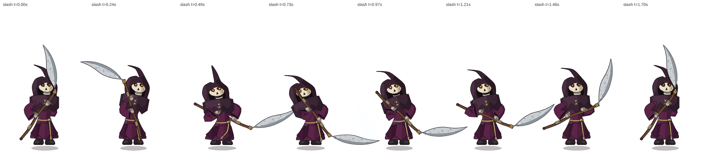

# Grim Reaper — a Brawlhalla-style character built entirely in code

A chibi reaper in flat cel-shaded vector art (one base colour, one shadow colour, a thick ink line),
drawn to a character sheet and rigged on the same 2D cut-out framework as the fox (`../fox`).
Nothing is painted: hood, mantle, robe with its layered hem, rope belt and tassels, hourglass,
skull, skeletal hands, boots and the crooked scythe are all Canvas 2D drawing code.



| Deliverable | Path |
|---|---|
| Interactive viewer | `viewer.html` — `npm run viewer`, then <http://localhost:8765/mascots/reaper/viewer.html> |
| Skeleton + channels | `src/skeleton.js` (29 bones: spine, head, two-link hood point, mantle, arms, legs, three robe flaps, tassel chain, scythe) |
| Solver | `src/solver.js` (FK, planted-foot IK, two-hand scythe grip with reach-slide, follow-through on hood, mantle, robe and tassels) |
| Artwork / draw order | `src/art.js`, `src/renderer.js` |
| Clips (9) | `src/clips.js` |
| Player | `src/rig.js` (events `reaper:<marker>`) |
| Validation (88 checks) | `scripts/validate.mjs` → `validation/report.json` |
| Game export | `scripts/export-game.mjs` → per clip: PNG sequence zip (512 px, true alpha), VP9 WebM with alpha, MP4 on pure green |

```bash
npm run reaper:validate   # pure-Node structural checks
npm run reaper:sheets     # contact sheets for every clip
npm run reaper:preview    # GIF per clip
npm run reaper:export     # game export (ffmpeg + zip)
```

## Rig notes

* The scythe bone **pivots between the hands**: grip markers sit at ±13 % of the shaft either side of
  the pivot, the butt at −50 % and the blade at +44 %. Swinging the bone swings the blade around the
  hands, so the grips stay in reach. If a key would still pull a grip beyond an arm (or too close to the
  shoulder), the solver slides the whole scythe toward or away from that shoulder before solving the arms.
* Follow-through is stateless (re-sampling the primary pose at `t − delay`): the hood point and mantle
  trail the head and chest, the robe flaps and tassels trail the hips.
* Channels: `eyeGlow`, `eyeSize`, `jaw`, `brow`, `hand_L/R` (finger curl), `hourglassSpin`, `trail`
  (blade motion trail), `propBehind` / `armLFront` / `armRFront` (stepped draw-order switches), `hoverShadow`.

## Clips

| clip | loop | content | markers |
|---|---|---|---|
| `idle` | ✓ 6 s | stationary stance; only the socket glints pulse | |
| `hover` | ✓ 4 s | floating bob, robe and hood drifting, tassels swinging | |
| `walk` | ✓ 0.9 s | treadmill shuffle, robe swinging | |
| `slash` | 1.7 s | wind-up over the right shoulder, low sweeping cut with a motion trail, recover | `windup` `hit` `recover` |
| `spin` | 1.5 s | full twirl of the scythe in front of the body | `hit` `hit2` |
| `hurt` | 1.2 s | knocked back, jaw drops, glints flicker | `hit` |
| `taunt` | 2.2 s | lifts the scythe and cackles, hourglass spins | `laugh` |
| `jump` | 1.5 s | crouch, leap with the robe billowing, squash landing | `takeoff` `apex` `land` |
| `death` | 2.0 s | drops the scythe, collapses, glints go out | `drop` `down` |

Validated per clip at 60 Hz: constant bone lengths, planted feet, hands on the grip (≤ 18.6 px wrist to
marker), stepped draw-order channels, bounded follow-through, determinism, seamless loops; the idle moves
no bone; the slash blade is high at the wind-up, low in front at the hit and moves faster than 2000 px/s
through the cut; the death ends with the scythe on the ground and the glints out; the player fires markers
once per pass at any frame step and never on scrub.
